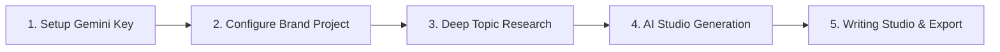

# BlogForge ⚡

<p align="center">
  <strong>A local-first, privacy-focused desktop studio for Google Gemini AI content research, anti-slop editorial drafting, and multi-format publishing.</strong>
</p>

<p align="center">
  
  
  
  
  
  
  
</p>

<p align="center">
  <a href="#key-features">Features</a> •
  <a href="#step-by-step-walkthrough-guide">Step-by-Step Guide</a> •
  <a href="#google-gemini-ai-studio">Google Gemini AI</a> •
  <a href="#anti-ai-slop-editorial-standards">Anti-Slop Engine</a> •
  <a href="#quick-start">Quick Start</a> •
  <a href="#interactive-gui-tutorial">Interactive Tutorial</a> •
  <a href="#keyboard-shortcuts">Shortcuts</a> •
  <a href="#repository-topics--seo">SEO Topics</a> •
  <a href="#architecture">Architecture</a>
</p>

---

## 1. Introduction

**BlogForge** is a modern desktop workspace engineered for technical writers, content creators, journalists, and developer marketers. It bridges the gap between chaotic raw AI chats and production-ready editorial publishing.

Instead of generic, robotic AI text stuffed with hallucinations and buzzwords, BlogForge enforces strict **Brand Voice Profiles**, leverages a **Topic-Aware Context Engine**, and executes an **Iterative Multi-Stage Generation Pipeline** (Outline → Section-by-Section Writing → Critical Review → FAQ Synthesis) powered exclusively by **Google Gemini** models using the official `google-genai` SDK: **Gemini 3.8 Flash**, **Gemini 3.5 Flash-Lite**, and the next-generation **Gemini 4 series** (`gemini-4-hydrogen`, `gemini-4-argon`, `gemini-4-carbon`).

Best of all, BlogForge is **local-first**: all your projects, brand guidelines, articles, research reports, and drafts remain strictly on your workstation in the `data/` directory.

---

## 2. Project Purpose

Content generation tools often fail developers and technical founders in three key areas:
1. **Cloud Lock-in & Privacy Leaks:** Projects and unpublished drafts are stored on remote multi-tenant databases.
2. **Context Bloat & Irrelevant Mentions:** Dumping entire brand guides into prompts causes models to mention unrelated products or spam internal links.
3. **Monolithic Hallucinations & AI Slop:** Asking an LLM to generate a 3,000-word article in a single prompt yields shallow, repetitive paragraphs filled with generic metaphors, superficial bullet lists, and fabricated claims.

**BlogForge solves this** by providing:
- An offline-first local file store (`data/projects/`, `data/articles/`, `data/research/`).
- Intelligent tokenized keyword matching that injects only relevant products and links for each specific topic.
- A section-by-section writing pipeline with system-level defenses against prompt injection and fake testimonials.
- A built-in **Anti-AI Slop Editorial Engine** that enforces human prose rhythm, bans 35+ machine clichés, and demands concrete technical evidence.
- Native integration with **Google Gemini** taking full advantage of low-latency generation, configurable thinking budgets (`low`, `medium`, `high`), and strict Pydantic JSON schemas.

---

## 3. Key Features

- 🖥️ **Editorial Paper Desktop Experience (PySide6 / Qt6):** Crafted with a warm editorial paper palette, elegant serif typography, crisp document canvas, and responsive split-pane manuscript editing.
- 🏢 **Multi-Brand & Project Governance:** Manage multiple websites or SaaS products with distinct brand tones, writing styles, preferred vocabulary, and rules.
- 🎯 **Topic-Aware Context Filtering:** Dynamically matches products and internal URLs relevant to the topic, eliminating keyword stuffing and context bloat.
- ⚡ **Google Gemini AI Studio:** Built from the ground up on the modern Google GenAI SDK (`google-genai`), supporting Gemini 3.8 Flash, 3.5 Flash-Lite, and the Gemini 4 family with real-time model discovery and thinking budget control (`low`, `medium`, `high`).
- 🛡️ **Anti-AI Slop Standards:** Strict prohibition against machine clichés ("delve into", "rich tapestry", "game-changer", "fast-paced world"), banned rhetorical question hooks, and enforced syntactic variety.
- 📝 **Iterative Generation Pipeline:** Generates structured outlines first, writes each section independently with real-time UI progress updates, and saves intermediate drafts automatically.
- 🔍 **Autonomous Research Engine:** Generates strategic search queries, analyzes competitive search landscapes, and discovers untapped content gaps.
- 📋 **Integrated Fact-Check & Heuristic Review:** Scans drafts for unsupported claims, n-gram repetition, duplicate paragraphs, and brand vocabulary compliance.
- 🌐 **Direct Next.js Export:** Validates directory permissions and exports structured Markdown or JSON directly into Next.js blog repositories.
- 📤 **Multi-Format Exporters:** Export articles as clean Markdown, semantic HTML, or JSON.
- 🧭 **Built-In Interactive GUI Tutorial:** Multi-step visual walkthrough directly in the desktop application (`TutorialDialog`), accessible from the top header navigation and Home dashboard.

---

## 4. Step-by-Step Walkthrough Guide

Follow this end-to-end guide to go from first launch to published article:



### Step 1: Configure Google Gemini AI
1. Launch BlogForge and click the **Settings** tab (or press the top-bar **Tutorial** button for an interactive tour).
2. Enter your Google AI Studio API key (starts with `AIza...`).
3. Click **Save Key**, then click **Test Connection** to confirm live connectivity.
4. Choose your active Gemini model (Recommended: `gemini-3.8-flash`).
5. Select your desired **Thinking Budget**:
   - `low`: Ultra-fast drafting for simple guides.
   - `medium`: Balanced depth for substantive, evidence-grounded prose.
   - `high`: Deep analytical reasoning for complex technical and architecture deep-dives.

### Step 2: Establish Brand Voice & Project Context
1. Click the **Projects** tab.
2. Create or select a project (e.g. *DevOps Central* or *Fintech Insights*).
3. Fill in the **Brand Profile**:
   - **Audience:** Senior Engineers, Founders, Decision Makers.
   - **Tone:** Authoritative, direct, conversational, or educational.
   - **Avoided Terms:** Enter banned buzzwords specific to your publication.
4. Add your **Product Catalog** with names, descriptions, and CTA links.
5. Register high-priority **Internal Links** with target keywords. The Topic-Aware Context Engine will intelligently link them only when relevant.

### Step 3: Run Research & Competitor Landscape
1. Switch to the **Research** tab.
2. Enter your target topic (e.g., *"Kubernetes Cost Optimization in 2026"*).
3. Click **Run Research**. Gemini analyzes the topic, generates search queries, synthesizes consensus facts, and highlights content gaps.
4. Click **Create Article from Research** to pre-populate the AI Studio with verified sources and key angles.

### Step 4: Autonomous Article Generation
1. Click the **AI Studio** button in the top navigation bar.
2. Enter or review the article topic, target audience, and content format.
3. Click **Generate Outline**. Review the generated sections, headings, and key points.
4. Click **Generate Full Article**. The iterative pipeline writes section by section, displaying real-time progress and saving recovery checkpoints.
5. Automated quality checks execute, validating readability and generating a tailored FAQ schema.

### Step 5: Refine in Writing Studio & Multi-Format Export
1. Click the **Writing** tab to open your generated manuscript.
2. Choose your view mode: **Split View** (side-by-side Markdown & live HTML preview), **Editor Only**, or **Preview Only**.
3. Edit your manuscript directly. Word count, character count, and reading time update in real time.
4. Press `Ctrl+S` to save your draft locally.
5. Select your export format (**Markdown**, **HTML**, **JSON**) and click **Export**, or sync directly to a local **Next.js** project repository!

---

## 5. Google Gemini AI Studio

BlogForge leverages Google's premier generative AI models through an optimized, typed provider architecture:

| Model | Context & Speed | Ideal Use Case |
| :--- | :--- | :--- |
| **`gemini-3.8-flash`** *(Default)* | High token speed & fast reasoning | Flagship recommendation for outlines, drafting, and anti-slop review. |
| **`gemini-3.5-flash-lite`** | Ultra-fast & lightweight | Rapid drafts, topic ideation, and keyword extraction. |
| **`gemini-4-hydrogen`** | High performance preview | Complex domain topics, deep research synthesis, and technical manuals. |
| **`gemini-4-argon`** | Balanced multimodal preview | Multimodal analysis, architecture walkthroughs, and technical diagrams. |
| **`gemini-4-carbon`** | Heavy reasoning preview | Deep analytical essays, intricate code breakdowns, and nuanced critiques. |

### Configurable Thinking Budget
Tune the depth of reasoning for Gemini models directly from **Settings & Gemini Model Studio**:
- **`low`**: Optimized for rapid turnaround on structured sections.
- **`medium`** *(Default)*: Balanced depth for substantive, evidence-grounded prose.
- **`high`**: Deep analytical reasoning for complex technical topics.

### Live Account Model Discovery
Click **Discover Models** in Settings to query the official Google Gemini API and discover all models accessible to your Google AI Studio account.

---

## 6. Anti-AI Slop Editorial Standards

BlogForge eliminates generic, predictable AI-isms through a rigorous multi-tier editorial enforcement system:

1. **Banned Clichés (35+ Patterns):** Phrases such as *"in today's fast-paced digital world"*, *"delve into"*, *"rich tapestry"*, *"game-changer"*, *"panacea"*, *"testament to"*, *"paradigm shift"*, *"unlock the power of"*, and *"embark on a journey"* are banned in prompt guidelines and flagged by automated heuristic reviewers.
2. **Syntactic Cadence & Variety:** Prohibits monotonous paragraph structures. Demands a natural mix of concise, punchy assertions and detailed analytical sentences.
3. **No Rhetorical Question Openings:** Forbids starting sections with questions like *"Have you ever wondered...?"* or *"Why does this matter?"*. Requires direct, insightful topic sentences.
4. **Concrete Evidence & Technical Mechanics:** Replaces vague generalizations with explicit protocols, exact flags, benchmark metrics, architectural tradeoffs, and step-by-step code demonstrations.
5. **Real-Time Heuristic Quality Review:** Calculates readability, flags repetitive n-grams, identifies duplicate paragraphs, and checks brand-avoided vocabulary before publishing.

---

## 7. Interactive GUI Tutorial

BlogForge includes a dedicated, interactive GUI guided tour (`TutorialDialog`) accessible right from the application:
- Click the **"Tutorial"** button in the top navigation header bar anytime.
- Click the **"Tutorial"** button in the Home workspace action bar.
- The 5-step carousel guides you through:
  1. Setting up Google Gemini AI credentials and thinking budgets.
  2. Configuring brand guidelines, personas, products, and links.
  3. Running deep research and topic landscape exploration.
  4. Operating the autonomous AI Article Production Studio.
  5. Editing in the Writing Studio and executing multi-format exports.
- Includes quick-jump action shortcuts to navigate directly to each studio view.

---

## 8. Keyboard Shortcuts

| Shortcut | Context | Action |
| :--- | :--- | :--- |
| `Ctrl+S` | Writing Studio | Save active draft locally to disk |
| `Ctrl+N` | Writing Studio | Create a new blank draft manuscript |
| `Ctrl+Enter` | Dialogs / Prompts | Execute primary dialog action |
| `Esc` | Modals / Dialogs | Cancel or dismiss active dialog |

---

## 9. Repository Topics & SEO

This repository is optimized for search and discovery across developer communities. When configuring this repository on GitHub, the following **SEO Topic Tags** are applied:

```
gemini, google-gemini, pyside6, qt6, ai-writing, blog-generator, article-writer, content-creation, seo, anti-slop, desktop-app, markdown-editor, nextjs, local-first, editorial-studio, gemini-3-flash, gemini-4
```

### Apply Topics via GitHub CLI
If you have the GitHub CLI installed, you can apply all topics in one command:
```bash
gh repo edit rafayshhh/blogforge --add-topic "gemini" --add-topic "google-gemini" --add-topic "pyside6" --add-topic "qt6" --add-topic "ai-writing" --add-topic "blog-generator" --add-topic "article-writer" --add-topic "content-creation" --add-topic "seo" --add-topic "anti-slop" --add-topic "desktop-app" --add-topic "markdown-editor" --add-topic "nextjs" --add-topic "local-first" --add-topic "editorial-studio"
```

---

## 10. Technology Stack

- **Runtime:** Python 3.11, 3.12, 3.13 (Python 3.12 recommended)
- **Desktop UI Framework:** PySide6 (Qt for Python 6.8+)
- **AI Intelligence:** Google GenAI SDK (`google-genai>=2.20.0,<3.0.0`)
- **Data Modeling & Validation:** Pydantic v2 (`pydantic>=2.10.0,<3.0.0`)
- **Configuration:** Python-Dotenv
- **Resilience:** Tenacity (exponential backoff retry loops)
- **Syntax Highlighting:** Pygments
- **Testing & Quality:** Pytest, Flake8, Mypy

---

## 11. Quick Start

### Windows (Automated Setup)
Clone the repository and run the setup script:
```cmd
git clone https://github.com/rafayshhh/blogforge.git
cd BlogForge
setup.bat
```
Then launch the application:
```cmd
run.bat
```

### Manual Installation (All Platforms)
1. **Clone the repository:**
   ```bash
   git clone https://github.com/rafayshhh/blogforge.git
   cd BlogForge
   ```

2. **Create and activate a virtual environment:**
   ```bash
   # Windows
   python -m venv .venv
   .\.venv\Scripts\activate

   # Linux / macOS
   python3 -m venv .venv
   source .venv/bin/activate
   ```

3. **Install dependencies:**
   ```bash
   pip install --upgrade pip
   pip install -r requirements.txt
   pip install -e .
   ```

4. **Configure environment:**
   ```bash
   cp .env.example .env
   ```
   Add your Google Gemini API key inside `.env` (or enter it in the app GUI under Settings):
   ```env
   GEMINI_API_KEY=AIzaSy...your_gemini_api_key_here
   GEMINI_MODEL=gemini-3.8-flash
   GEMINI_THINKING_LEVEL=medium
   ```

5. **Run BlogForge:**
   ```bash
   python -m app.main
   ```

---

## 12. Testing & Quality Assurance

Run the comprehensive test suite with pytest:
```bash
pytest tests/ -p no:cov -p no:anyio
```

Check static type annotations with mypy:
```bash
mypy app --explicit-package-bases --ignore-missing-imports
```

Verify PEP 8 compliance with flake8:
```bash
flake8 app tests --max-line-length=120
```

---

## 13. Project Architecture

BlogForge strictly separates UI components from core business logic:

```
BlogForge/
├── .github/workflows/     # CI workflow with headless Qt6 offscreen matrix tests
├── app/
│   ├── core/              # Config loader, logging, exceptions, constants
│   ├── models/            # Domain models (Article, Section, SEO, Provider)
│   ├── projects/          # Project CRUD, brand profiles, and JSON repository
│   ├── providers/         # Google Gemini provider and Search provider
│   ├── generation/        # Outline, writer, reviewer, pipeline orchestration
│   ├── content/           # Topic-aware contextual filtering engine
│   ├── export/            # Markdown, HTML, JSON exporters
│   ├── integrations/      # Next.js export synchronization
│   └── ui/                # PySide6 desktop views, theme, and main window
│       └── components/    # Reusable dialogs, forms, and TutorialDialog
├── data/                  # Local projects, manuscripts, drafts, and research runs
├── docs/                  # In-depth architectural & developer guides
├── screenshots/           # Application screenshots and visual assets
└── tests/                 # Unit, integration, workflow, and stress test suites
```

*(Note: All project definitions, brand profiles, and articles are stored locally in the `data/` directory, ensuring complete offline-first privacy).*

---

## 14. Publisher, Transparency & Support

- **Publisher:** KreateKode
- **Developer:** KreateKode Dev Team
- **Official Repository:** [https://github.com/rafayshhh/blogforge](https://github.com/rafayshhh/blogforge)
- **Local-First Transparency:** BlogForge contains **zero advertisements**, **zero analytics tracking**, and **zero telemetry**.
- **Direct Connection:** Your Google Gemini API requests travel directly between your machine and Google Generative AI endpoints. No middleman proxies or multi-tenant database relays.

---

## 15. License

BlogForge is released as open-source software under the [MIT License](LICENSE).  
Copyright (c) 2026 KreateKode / RafayShhh.
