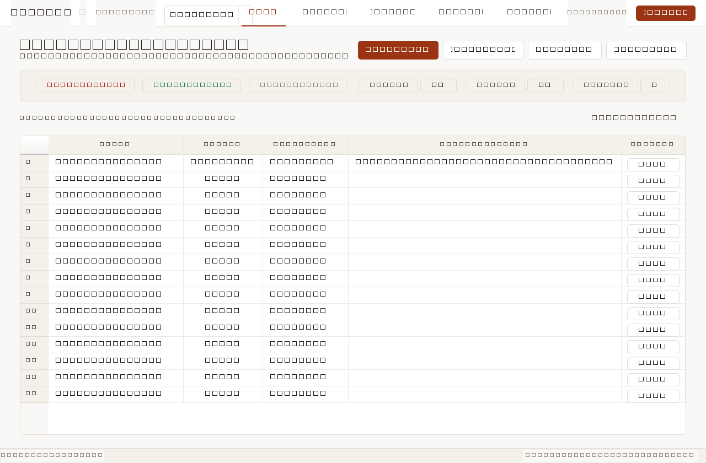
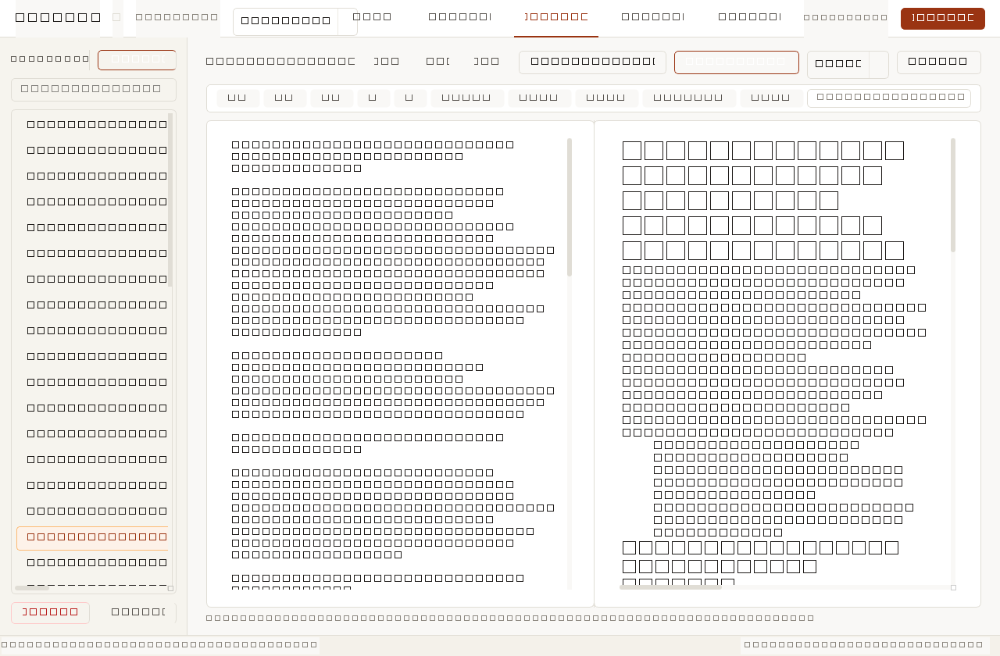
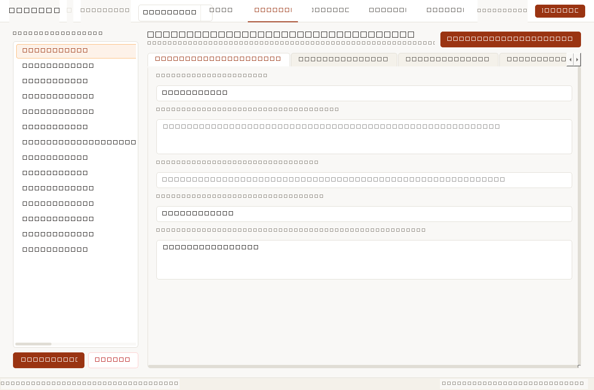
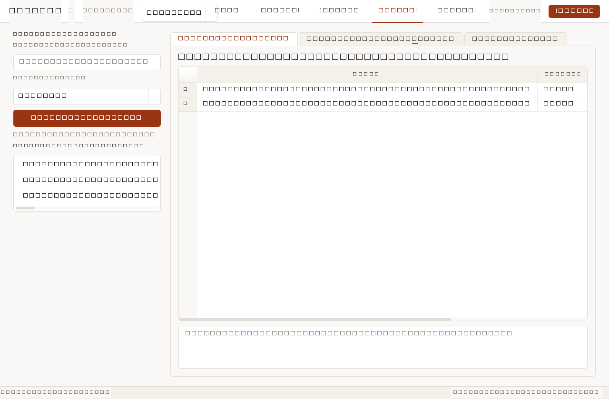
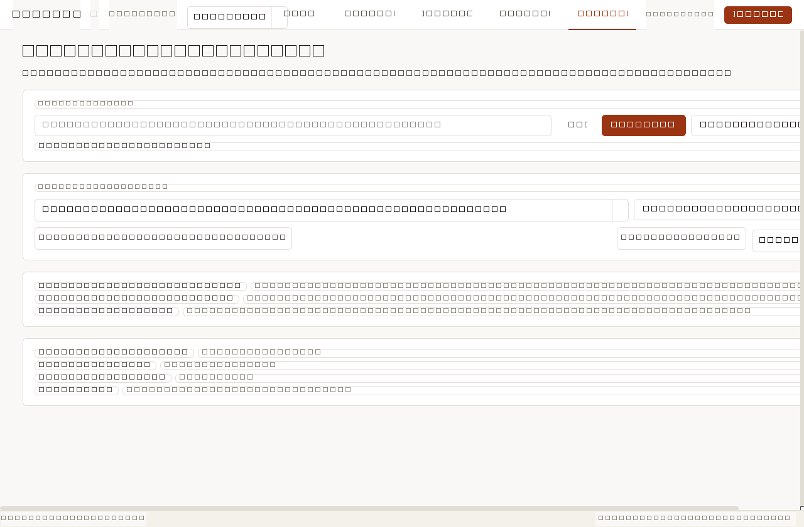

# BlogForge ⚡

<p align="center">
  <strong>A local-first, privacy-focused desktop studio for Google Gemini AI content research, anti-slop editorial drafting, and multi-format publishing.</strong>
</p>

<p align="center">
  <a href="#key-features">Features</a> •
  <a href="#google-gemini-ai-studio">Google Gemini AI</a> •
  <a href="#anti-ai-slop-editorial-standards">Anti-Slop Engine</a> •
  <a href="#quick-start">Quick Start</a> •
  <a href="#architecture">Architecture</a> •
  <a href="#documentation">Documentation</a> •
  <a href="#contributing">Contributing</a>
</p>

---

## 1. Introduction

**BlogForge** is a modern desktop workspace engineered for technical writers, content creators, journalists, and developer marketers. It bridges the gap between chaotic raw AI chats and production-ready editorial publishing.

Instead of generic, robotic AI text stuffed with hallucinations and buzzwords, BlogForge enforces strict **Brand Voice Profiles**, leverages a **Topic-Aware Context Engine**, and executes an **Iterative Multi-Stage Generation Pipeline** (Outline → Section-by-Section Writing → Critical Review → FAQ Synthesis) powered exclusively by **Google Gemini** models using the official `google-genai` SDK: **Gemini 3.8 Flash**, **Gemini 3.5 Flash-Lite**, and the next-generation **Gemini 4 series** (`gemini-4-hydrogen`, `gemini-4-argon`, `gemini-4-carbon`).

Best of all, BlogForge is **local-first**: all your projects, brand guidelines, articles, research reports, and drafts remain strictly on your workstation.

---

## 2. Project Purpose

Content generation tools often fail developers and technical founders in three key areas:
1. **Cloud Lock-in & Privacy Leaks:** Projects and unpublished drafts are stored on remote multi-tenant databases.
2. **Context Bloat & Irrelevant Mentions:** Dumping entire brand guides into prompts causes models to mention unrelated products or spam internal links.
3. **Monolithic Hallucinations & AI Slop:** Asking an LLM to generate a 3,000-word article in a single prompt yields shallow, repetitive paragraphs filled with generic metaphors, superficial bullet lists, and fabricated claims.

**BlogForge solves this** by providing:
- An offline-first local file store (`data/projects/`, `data/articles/`, `data/research/`).
- Intelligent tokenized keyword matching that injects only relevant products and links for each specific topic.
- A section-by-section writing pipeline with system-level defenses against prompt injection and fake testimonials.
- A built-in **Anti-AI Slop Editorial Engine** that enforces human prose rhythm, bans 35+ machine clichés, and demands concrete technical evidence.
- Native integration with **Google Gemini** taking full advantage of low-latency generation, configurable thinking budgets, and strict Pydantic JSON schemas.

---

## 3. Key Features

- 🖥️ **Editorial Paper Desktop Experience (PySide6 / Qt):** Crafted with a warm editorial paper palette, elegant serif typography, crisp document canvas, and responsive split-pane manuscript editing.
- 🏢 **Multi-Brand & Project Governance:** Manage multiple websites or SaaS products with distinct brand tones, writing styles, preferred vocabulary, and rules.
- 🎯 **Topic-Aware Context Filtering:** Dynamically matches products and internal URLs relevant to the topic, eliminating keyword stuffing and context bloat.
- ⚡ **Google Gemini AI Studio:** Built from the ground up on the modern Google GenAI SDK (`google-genai`), supporting Gemini 3.8 Flash, 3.5 Flash-Lite, and the Gemini 4 family with real-time model discovery and thinking budget control (`low`, `medium`, `high`).
- 🛡️ **Anti-AI Slop Standards:** Strict prohibition against machine clichés ("delve into", "rich tapestry", "game-changer", "fast-paced world"), banned rhetorical question hooks, and enforced syntactic variety.
- 📝 **Iterative Generation Pipeline:** Generates structured outlines first, writes each section independently with real-time UI progress updates, and saves intermediate drafts automatically.
- 🔍 **Autonomous Research Engine:** Generates strategic search queries, analyzes competitive search landscapes, and discovers untapped content gaps.
- 📋 **Integrated Fact-Check & Heuristic Review:** Scans drafts for unsupported claims, n-gram repetition, duplicate paragraphs, and brand vocabulary compliance.
- 🌐 **Direct Next.js Export:** Validates directory permissions and exports structured Markdown or JSON directly into Next.js blog repositories.
- 📤 **Multi-Format Exporters:** Export articles as clean Markdown, semantic HTML, or JSON.

---

## 4. Google Gemini AI Studio

BlogForge leverages Google's premier generative AI models through an optimized, typed provider architecture:

| Model | Context & Speed | Ideal Use Case |
| :--- | :--- | :--- |
| **`gemini-3.8-flash`** *(Default)* | High token speed & fast reasoning | Recommended flagship for outlines, drafting, and anti-slop review. |
| **`gemini-3.5-flash-lite`** | Ultra-fast & lightweight | Quick drafts, rapid topic ideation, and keyword extraction. |
| **`gemini-4-hydrogen`** | High performance preview | Complex domain topics, deep research synthesis, and technical manuals. |
| **`gemini-4-argon`** | Balanced multimodal preview | Multimodal analysis, architecture walkthroughs, and technical diagrams. |
| **`gemini-4-carbon`** | Heavy reasoning preview | Deep analytical essays, intricate code breakdowns, and nuanced critiques. |

### Configurable Thinking Budget
Tune the depth of reasoning for Gemini models directly from **Settings & Gemini Model Studio**:
- **`low`**: Optimized for rapid turnaround on structured sections.
- **`medium`** *(Default)*: Balanced depth for substantive, evidence-grounded prose.
- **`high`**: Deep analytical reasoning for complex technical topics.

### Live Account Model Discovery
Click **Discover Models** in Settings to query the official Google Gemini API and discover all models available to your Google AI Studio account.

---

## 5. Anti-AI Slop Editorial Standards

BlogForge eliminates generic, predictable AI-isms through a rigorous multi-tier editorial enforcement system:

1. **Banned Clichés (35+ Patterns):** Phrases such as *"in today's fast-paced digital world"*, *"delve into"*, *"rich tapestry"*, *"game-changer"*, *"panacea"*, *"testament to"*, *"paradigm shift"*, *"unlock the power of"*, and *"embark on a journey"* are banned in prompt guidelines and flagged by automated heuristic reviewers.
2. **Syntactic Cadence & Variety:** Prohibits monotonous paragraph structures. Demands a natural mix of concise, punchy assertions and detailed analytical sentences.
3. **No Rhetorical Question Openings:** Forbids starting sections with questions like *"Have you ever wondered...?"* or *"Why does this matter?"*. Requires direct, insightful topic sentences.
4. **Concrete Evidence & Technical Mechanics:** Replaces vague generalizations with explicit protocols, exact flags, benchmark metrics, architectural tradeoffs, and step-by-step code demonstrations.
5. **Real-Time Heuristic Quality Review:** Calculates readability, flags repetitive n-grams, identifies duplicate paragraphs, and checks brand-avoided vocabulary before publishing.

---

## 6. Technology Stack

- **Runtime:** Python 3.11+ (Python 3.12 recommended)
- **Desktop UI:** PySide6 (Qt for Python 6.8+)
- **AI Intelligence:** Google GenAI SDK (`google-genai>=2.20.0,<3.0.0`)
- **Data Modeling & Validation:** Pydantic v2 (`pydantic>=2.10.0,<3.0.0`)
- **Configuration:** Python-Dotenv
- **Resilience:** Tenacity (exponential backoff retry loops)
- **Syntax Highlighting:** Pygments
- **Testing & Quality:** Pytest, Flake8, Mypy

---

## 7. Application Interface

```text
+-----------------------------------------------------------------------------------------------+
| BLOGFORGE  │  Workspace: [DevPortal ▼]    [Home]  [Projects]  [Writing]  [Research] [Settings]|
+-----------------------------------------------------------------------------------------------+
|  Active Workspace: DevPortal • Local Publishing Studio                          [AI Studio]   |
|                                                                                               |
|  Recent Manuscripts                                Readiness Checklist                        |
|  +-----------------------------------------------+ +----------------------------------------+ |
|  | Title                   | Status  | Words     | | ● Gemini Configured (gemini-3.8-flash) | |
|  |-------------------------+---------+-----------| | ● Project Active                       | |
|  | Low-Latency eBPF Observ | Draft   | 1,420     | | ○ Next.js Sync Off                     | |
|  +-----------------------------------------------+ +----------------------------------------+ |
+-----------------------------------------------------------------------------------------------+
```

### Visual Tour

#### Home Workspace & Editorial Dashboard


#### Editorial Writing Studio (Split-Pane Manuscript Editor & Live Preview)


#### Projects & Brand Style Guide Governance


#### Research Intelligence & Topic Landscapes


#### Settings & Gemini Model Diagnostics


---

## 8. Project Architecture

BlogForge strictly separates UI components from core business logic:

```
BlogForge/
├── app/
│   ├── core/              # Config loader, logging, exceptions, constants
│   ├── models/            # Domain models (Article, Section, SEO, Provider)
│   ├── projects/          # Project CRUD, brand profiles, and JSON repository
│   ├── providers/         # Google Gemini provider and Search provider
│   ├── generation/        # Outline, writer, reviewer, pipeline orchestration
│   ├── content/           # Topic-aware contextual filtering engine
│   ├── export/            # Markdown, HTML, JSON exporters
│   ├── integrations/      # Next.js export synchronization
│   └── ui/                # PySide6 desktop views, theme, and main window
├── data/                  # Local projects, manuscripts, generated drafts, and research runs
├── docs/                  # In-depth architectural & developer guides
├── screenshots/           # Application screenshots and visual assets
└── tests/                 # Unit and integration test suite
```

*(Note: All project definitions, brand profiles, and articles are stored locally in the `data/` directory, ensuring complete offline-first privacy).*

Detailed architectural diagrams are documented in [`docs/ARCHITECTURE.md`](docs/ARCHITECTURE.md).

---

## 9. Prerequisites

- Python 3.11 or newer (Python 3.12 recommended).
- A Google Gemini API Key from [Google AI Studio](https://aistudio.google.com/).

---

## 10. Quick Start

### Windows (Automated Setup)
Clone the repository and run the setup script:
```cmd
git clone https://github.com/rafayshhh/blogforge.git
cd BlogForge
setup.bat
```
Then launch the application:
```cmd
run.bat
```

### Manual Installation (All Platforms)
1. **Clone the repository:**
   ```bash
   git clone https://github.com/rafayshhh/blogforge.git
   cd BlogForge
   ```

2. **Create and activate a virtual environment:**
   ```bash
   # Windows
   python -m venv .venv
   .\.venv\Scripts\activate

   # Linux / macOS
   python3 -m venv .venv
   source .venv/bin/activate
   ```

3. **Install dependencies:**
   ```bash
   pip install --upgrade pip
   pip install -r requirements.txt
   pip install -e .
   ```

4. **Configure environment:**
   ```bash
   cp .env.example .env
   ```
   Add your Google Gemini API key inside `.env` (or enter it in the app GUI under Settings):
   ```env
   AI_PROVIDER=gemini
   GEMINI_API_KEY=your_gemini_api_key_here
   GEMINI_MODEL=gemini-3.8-flash
   GEMINI_THINKING_LEVEL=medium
   ```

5. **Run BlogForge:**
   ```bash
   python -m app.main
   ```

---

## 11. Testing & Quality Assurance

Run the comprehensive test suite with pytest:
```bash
pytest tests/ -p no:cov -p no:anyio
```

Check static type annotations with mypy:
```bash
mypy app --explicit-package-bases --ignore-missing-imports
```

Verify PEP 8 compliance with flake8:
```bash
flake8 app tests --max-line-length=120
```

---

## 12. Programmatic Python API

You can import and use BlogForge's generation pipeline in your own scripts:

```python
from app.providers.factory import create_provider
from app.generation.pipeline import GenerationPipeline
from app.generation.models import GenerationRequest

# 1. Instantiate Google Gemini provider
ai = create_provider(provider_name="gemini", api_key="AIzaSy...")

# 2. Initialize the generation pipeline
pipeline = GenerationPipeline(ai)

req = GenerationRequest(
    topic="Optimizing Linux eBPF Ring Buffers for High-Throughput Networking",
    audience="Systems Architects & Linux Kernel Engineers",
    content_type="In-Depth Technical Guide"
)

# 3. Generate structured outline with anti-slop guidelines
outline = pipeline.generate_outline(req)

# 4. Write section-by-section with live progress tracking
article = pipeline.generate_article(req, outline, progress_callback=lambda msg: print(f"Progress: {msg}"))

# 5. Finalize with automated quality review and FAQ generation
final = pipeline.finalize_article(article, req)

print(f"Generated manuscript '{final.title}' with {len(final.sections)} sections ({len(final.content.split())} words).")
```

For complete details, see [`docs/API.md`](docs/API.md).

---

## 13. Known Limitations

- **Web Search Provider:** BlogForge includes a `MockSearchProvider` out of the box for testing and deterministic generation. Integration with live search APIs (e.g. Google Search Grounding or Serper) is pluggable via `SearchProvider`.
- **Desktop Single-User:** BlogForge is optimized for single-workstation local development rather than multi-user concurrent team editing.

---

## 14. Documentation Index

- [Architecture Overview](docs/ARCHITECTURE.md)
- [Development Guide](docs/DEVELOPMENT.md)
- [Packaging & Distribution Guide](docs/DEPLOYMENT.md)
- [Python API Reference](docs/API.md)
- [Security Policy & Vulnerability Reporting](SECURITY.md)
- [Contributing Guidelines](CONTRIBUTING.md)
- [Code of Conduct](CODE_OF_CONDUCT.md)
- [Changelog](CHANGELOG.md)

---

## 15. Contributing

Contributions are warmly welcome! Please see [CONTRIBUTING.md](CONTRIBUTING.md) for details on code style, issue reporting, and pull request procedures.

---

## 16. License

BlogForge is released as open-source software under the [MIT License](LICENSE).  
Copyright (c) 2026 RafayShhh.

---

## 17. Acknowledgments

- Built with [PySide6](https://www.qt.io/qt-for-python) (The Qt Company).
- Powered exclusively by [Google GenAI SDK](https://github.com/google-gemini/generative-ai-python) and the Google Gemini family of models.
- Structured with [Pydantic](https://docs.pydantic.dev/).
